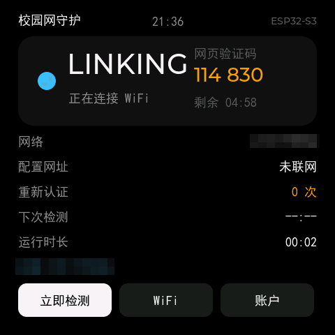
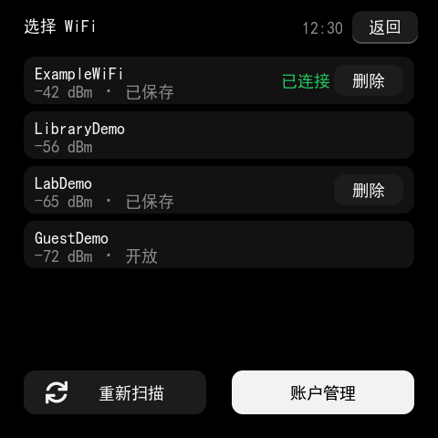
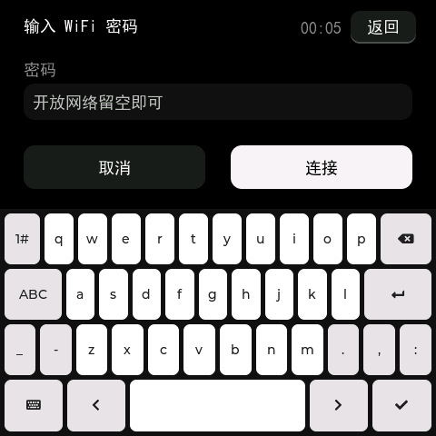
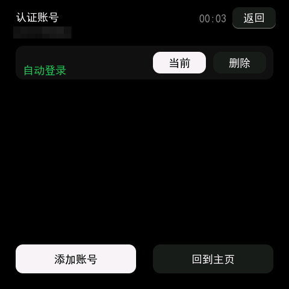
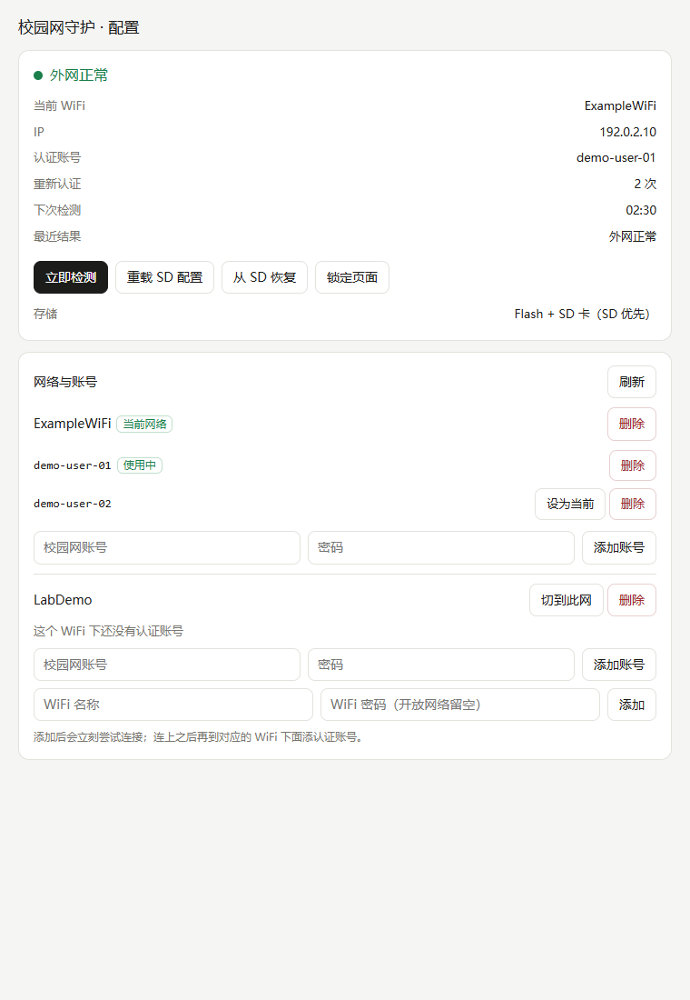
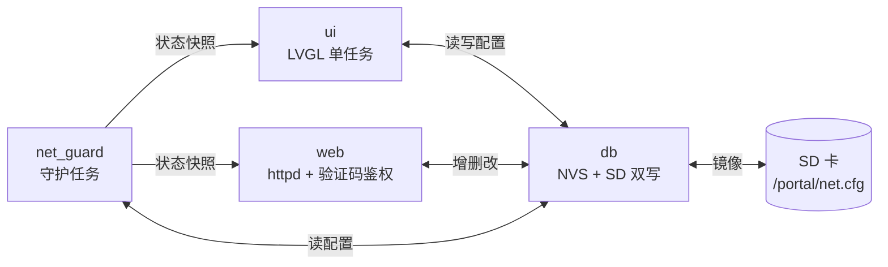

<div align="center">

# esp32s3-netkeeper

**把一块 ESP32-S3 触摸屏小板，变成会自己登录校园网的网守护**

检测外网 → 掉线自动重认证 → 5 分钟轮询 → 屏幕上看得见状态

[](LICENSE)
[](https://github.com/espressif/esp-idf)
[](https://lvgl.io)
[](https://www.espressif.com/)
[](https://www.waveshare.com/)
[](#实现细节教学向)

[](https://github.com/Tommie-P-xl/esp32s3-netkeeper/actions/workflows/ci.yml)
[](https://github.com/Tommie-P-xl/esp32s3-netkeeper/releases)

</div>

面向 **SRun Portal**（国内高校最常见的深澜认证系统）。移植到别的 Portal 系统
（Dr.COM、华为等）需要替换 `main/srun_port.c` 的登录流程，
细节见[第 14 节](#14-想换成别的-portal-系统drcom--华为--锐捷)。

> [!NOTE]
> 一块板子 = 一个不用管的网守护。第一次配网在屏幕上点两下，之后断电、换网、掉线都自己恢复；
> 配置同时存在 Flash 和 SD 卡，丢了哪一份都能救回来。

## 目录

- [界面预览](#界面预览)
- [支持硬件](#支持硬件)
- [功能](#功能)
- [编译与烧录](#编译与烧录)
- [自动化构建与发布](#自动化构建与发布)
- [配置存在哪、谁优先](#配置存在哪谁优先)
- [屏幕操作](#屏幕操作)
- [网页配置](#网页配置)
- [目录结构](#目录结构)
- [电池与功耗](#电池与功耗)
- [排错](#排错)
- [已知限制](#已知限制)
- [实现细节（教学向）](#实现细节教学向)
  - [1. 整体形状](#1-整体形状)
  - [2. 任务与线程模型](#2-任务与线程模型)
  - [3. 启动顺序（`app_main.c`）](#3-启动顺序app_mainc)
  - [4. 网络守护主循环（`net_guard.c`）](#4-网络守护主循环net_guardc)
  - [5. 外网探测：怎么判断有没有网、Portal 在哪（`srun_port.c`）](#5-外网探测怎么判断有没有网portal-在哪srun_portc)
  - [6. SRun 认证算法：三个字段是怎么算出来的（`srun_crypto.c`）](#6-srun-认证算法三个字段是怎么算出来的srun_cryptoc)
  - [7. 登录请求与响应判定（`srun_port.c`）](#7-登录请求与响应判定srun_portc)
  - [8. 配置库：一份数据，两处存储（`db.c`）](#8-配置库一份数据两处存储dbc)
  - [9. 局域网配置面板（`web.c` + `index.html`）](#9-局域网配置面板webc--indexhtml)
  - [10. UI：一条线程、一把锁、一套排版规则（`ui.c` / `ui_common.c` / `ui_setup.c`）](#10-ui一条线程一把锁一套排版规则uic--ui_commonc--ui_setupc)
  - [11. 电源管理（`power_mgr.c`）](#11-电源管理power_mgrc)
  - [12. 电池状态（`batt_mgr.c` + AXP2101）](#12-电池状态batt_mgrc--axp2101)
  - [13. 构建期配置（`sdkconfig.defaults` 里几个非默认项）](#13-构建期配置sdkconfigdefaults-里几个非默认项)
  - [14. 想换成别的 Portal 系统（Dr.COM / 华为 / 锐捷）](#14-想换成别的-portal-系统drcom--华为--锐捷)
- [技术路线与关键取舍](#技术路线与关键取舍)
- [踩坑记录](#踩坑记录)
  - [显示与 LVGL](#显示与-lvgl)
  - [触摸与空闲休眠](#触摸与空闲休眠)
  - [网页与认证](#网页与认证)
  - [电池与 PMIC](#电池与-pmic)
  - [构建、烧录与抓图工具](#构建烧录与抓图工具)
- [更新记录](#更新记录)
  - [v1.0.0 — 2026-11-02](#v100--2026-11-02)
- [许可](#许可)

## 界面预览

| 主页 | 选 WiFi |
|---|---|
|  |  |

| 输入 WiFi 密码 | 账号管理 |
|---|---|
|  |  |

| 添加账号 | 网页配置面板 |
|---|---|
|  |  |

> [!NOTE]
> 设备截图取自屏幕显存原分辨率 480×480。图中的 WiFi 名称、认证账号已做像素化 / 涂除处理，
> 网页面板截图为纯示例数据（`ExampleWiFi` / `10000000000`），均非真实信息。
> 主页状态卡里的电量这一行只在插了电池时出现（截图时插着 USB，所以显示「充电中」）。

---

## 支持硬件

| 项 | 说明 |
|---|---|
| 板子 | [Waveshare ESP32-S3-Touch-AMOLED-2.16](https://www.waveshare.com/)（ESP32-S3 N16R8） |
| 屏幕 | CO5300 480×480 AMOLED（QSPI）+ CST9217 触摸 |
| 存储 | 片上 NVS（必需）+ microSD（可选，1-bit SDMMC） |
| 电源 | AXP2101（I2C 0x34）：电池电压 / USB 在位 / 充放电状态 |
| 框架 | ESP-IDF **v6.1** |

换板子的话，只需要替换 `main/power_mgr.c` 里的显示/背光调用和
`managed_components` 里的 BSP，其余逻辑与硬件无关。

---

## 功能

- **自动认证**：探测 `generate_204`，被 302 劫持就抓 Portal 地址与 `ac_id` 并登录；
  登录成功后再探一次外网，确认真的通了才算成功。
- **5 分钟轮询，永不停止**：熄屏、降频状态下照跑；失败按 30/60/120 秒退避三次。
- **多 WiFi / 多账号**：一个 WiFi 可存多个认证账号，点一下切换。
- **三种配置方式**，改的都是同一份数据：
  1. 屏幕上点（扫描 → 输密码 → 选账号）
  2. 浏览器打开板子 IP（页面带增删改，需输入屏幕上的 6 位验证码解锁）
  3. 把 SD 卡插到电脑上直接改文本文件
- **网页验证码防护**：屏幕实时显示 6 位验证码（5 分钟换新）+ 倒计时，
  网页修改配置前必须先验证；已解锁的浏览器会话不受换码影响（7 天内有效）。
- **系统时钟**：所有界面顶部显示时间，联网后 SNTP 自动校时（东八区）。
- **双存储**：片上 NVS + SD 卡镜像，**SD 优先**（见下）。
- **自愈**：目标网络连不上会自动回退到上次成功的、或库里其它网络，
  不会因为填错一个 SSID 就把板子锁死。
- **省电**：10 秒无触摸熄屏，再 60 秒把 CPU 降到 80 MHz；触摸即亮。
- **电池状态**：插了电池就在状态卡里显示电量百分比；**用电池供电**时再给一条
  「预计还能用多久」（按当前亮屏/降频状态估算），**插着 USB 充电**时只显示电量和
  「充电中 / 已充满」、不估续航；**没插电池整行不显示**。

---

## 编译与烧录

需要 **ESP-IDF v6.1**。先在你的 IDF 目录里跑一次 `export.ps1`（或手动设置
`IDF_PATH` + `IDF_PYTHON_ENV_PATH`），然后：

```powershell
# 1. 编译
.\build.ps1

# 2. 烧录（默认 COM6，可传参）
.\flash.ps1 COM6
```

两个脚本都用 `$PSScriptRoot` 定位工程目录，放在任何路径下都能用；产物在
`build/esp32s3_netkeeper.bin`。首次编译时组件管理器会按 `main/idf_component.yml`
自动拉取 LVGL 与 BSP 到 `managed_components/`（不入库）。

> [!WARNING]
> **flash-mode 必须是 `dio`**。这个板子用 `qio` 烧录后 ROM 会在第一段加载后挂死，
> 表现为 TG0WDT 复位循环、串口一个字都看不到。`flash.ps1` 里已经写死 dio。

`flash.ps1` 烧完会自己做一次复位让固件跑起来。这一步有坑，值得说清楚：

- 这块板的 **EN 没有接到 USB 的 RTS**，所以 esptool 的 `--after hard-reset`（拉 RTS）
  在这里是**空操作**。烧完固件停在 ROM 下载模式，画面不亮、串口没日志、网页也打不开，
  看起来就像"固件编坏了"。
- 能用的是 `--after watchdog-reset`（CPU 级复位，会正常从 flash 启动），但它会让
  esptool 丢掉串口、返回非 0，所以脚本把它拆成两步：写入用 `no-reset`（退出码只反映写入结果），
  然后单独发一次 watchdog 复位、忽略它的返回码。
- 若复位后串口仍然安静，**长按 PWR 一次**（PMIC 全断电再上电）必定能起来。

首次开机若两块存储都为空，会用 `main/app_config.h` 里的默认值播种一份配置，
所以"改完宏定义烧一次"就能直接用。

`main/ui_font_18.c` 是提交进仓库的（约 730 KB），因此**不装 Node 也能直接编译**；
只有改了界面中文文案才需要重新生成，步骤见「[目录结构](#目录结构)」里的字体小节。

首次开机若两块存储都为空，会用 `main/app_config.h` 里的默认值播种一份配置，
所以"改完宏定义烧一次"就能直接用。

---

## 自动化构建与发布

`.github/workflows/ci.yml` 两件事：

| 触发 | 做什么 |
|---|---|
| push 到 `main` / PR | 在 `espressif/idf:v6.1` 容器里跑 `idf.py build`，同时打印告警数；产物上传成 Actions artifact（保留 30 天） |
| 推 `v*` tag | **先编译**（编不过就不发版），成功后用 `gh release create --generate-notes` 建 Release |

> [!NOTE]
> Release 里**不挂固件**。要 bin 就从 Actions 里下 artifact（`esp32s3-netkeeper-<sha>`，
> 含 `esp32s3_netkeeper.bin` / `bootloader.bin` / `partition-table.bin` / `flash_args`），
> 或者本地 `idf.py build`。

发一版只要两步：

```bash
git tag -a v1.0.0 -m "v1.0.0: 首个可用版本"
git push origin v1.0.0     # 推完 Actions 会自动建 Release
```

---

## 配置存在哪、谁优先

```
            ┌──────────────────────────┐
   修改 ───► │ 片上 NVS (namespace=portal) │  ◄── 始终写
            └──────────────────────────┘
                        │ 同时
                        ▼
            ┌──────────────────────────┐
            │ /sdcard/portal/net.cfg    │  ◄── 有卡才写
            └──────────────────────────┘

开机加载顺序：
  SD 有文件且能解析  ──► 用 SD，覆盖 NVS        （SD 优先）
  SD 没有/解析为空   ──► 用 NVS，顺手补写一份到 SD
  两边都空           ──► 用编译期默认值播种
```

- 没插卡：完全正常，配置只在片上 Flash。
- 插了卡：配置同时写两处，卡是备份；把卡拿到电脑上改完插回来，重启就生效。
- "能解析"的判定：至少有一个 `[SSID]` 段或至少一行 `active=`。
  所以卡里被存成乱码不会顶掉 Flash 里的配置。
- 网页上的「从 SD 恢复」可以强制用卡覆盖 Flash。

### 文件格式（`/portal/net.cfg`，UTF-8）

```ini
# 井号开头是注释
[general]
active=MyHomeWiFi        ; 开机自动连的 WiFi，也是守护目标
last_ok=MyHomeWiFi       ; 上次成功的网络，自动维护，不用手改

[MyHomeWiFi]             ; 段名就是 SSID，可以带空格
wifi=wifi密码            ; 开放网络留空
current=20230000000      ; 当前使用的认证账号
account=20230000000|密码1
account=13800000000|密码2 ; 一个 SSID 下可以写多行
```

容量上限 4000 字节（NVS 单条 blob 限制），够放十几组网络。

---

## 屏幕操作

| 位置 | 作用 |
|---|---|
| **立即检测** | 手动触发一次检测（只有点它才会立即检测，碰屏幕不算） |
| **WiFi** | 扫描列表（已保存的带「删除」）、选网、输密码 |
| **账户** | 当前 WiFi 下的账号：使用 / 删除 / 添加 |
| 顶部中间 | 系统时间（联网后自动校准） |
| 状态卡右侧 | 网页验证码 + 倒计时（网页改配置要用） |

- 10 秒无操作熄屏，再 60 秒降频休眠；点一下屏幕即亮。
- 没配网时，开机 2.5 秒后自动跳到扫描页。
- 触摸只负责唤醒，不会误触发检测。

---

## 网页配置

板子连上网后，屏幕「配置网址」那一行就是入口，浏览器打开即可：

```
http://192.168.x.x/
```

**修改配置需要先解锁**：输入板子屏幕右上角显示的 6 位验证码（每 5 分钟自动更换，
屏幕上有倒计时）。解锁后的浏览器会话 7 天内持续有效，不受换码影响；同一局域网
的其他设备需要自行输入验证码。

| 方法 | 路径 | 参数 | 说明 |
|---|---|---|---|
| GET | `/` | — | 配置页 |
| GET | `/api/state` | — | 状态 + 全部网络/账号（只读） |
| POST | `/api/auth` | `code` | 用验证码换 token |
| POST | `/api/wifi` | `token`,`ssid`,`pass`,`use` | 加/改 WiFi（新网络先试连，成功才切换） |
| POST | `/api/acct` | `token`,`ssid`,`user`,`pass`,`use` | 加/改认证账号 |
| POST | `/api/use` | `token`,`ssid`,`user` | 切换当前账号 |
| POST | `/api/remove` | `token`,`type=wifi\|acct`,`ssid`,`user` | 删除 |
| POST | `/api/check` | `token` | 立即检测 |
| POST | `/api/reload` | `token` | 重载配置 |
| POST | `/api/restore` | `token` | 用 SD 覆盖 Flash |

写接口缺少或 token 失效时返回 `{"ok":false,"need_auth":true}`。
连错 5 次验证码会锁 60 秒。

> 提示：如果浏览器一直显示「连接板子失败」，检查系统代理（如 Clash）
> 是否拦截了内网 IP，把 `192.168.*` 加进直连名单。

---

## 目录结构

```
main/
  app_main.c        启动顺序：NVS → 配置库 → 屏 → WiFi → 守护 → 网页
  app_config.h      编译期默认值（只在首次播种时用）
  db.{c,h}          配置库：NVS + SD 双写、SD 优先、INI 解析
  wifi_mgr.{c,h}    WiFi 连接/扫描/IP 状态（不含认证逻辑）
  net_guard.{c,h}   5 分钟轮询、掉线重认证、试连与回退
  srun_port.{c,h}   Portal 探测与 SRun 登录
  srun_crypto.{c,h} MD5/SHA1/HMAC-MD5 + XXTEA 变体 + SRun base64
  http_util.{c,h}   极简 HTTP GET（能抓 Location）
  web.{c,h}         局域网配置面板 + JSON API + 验证码鉴权
  sys_time.{c,h}    SNTP 校时 + 系统时间
  batt_mgr.{c,h}    电池：AXP2101 读电压/充放电状态，按功耗模型估续航
  ui.c              主界面
  ui_setup.c        选网 / 输密码 / 账号管理
  ui_common.{c,h}   配色、字体、按钮工厂、顶部时钟
  ui_font_18.c      生成的中文字体（勿手改）
  index.html        配置页（构建时嵌进固件）
tools/
  monitor.py        复位 + 抓串口日志（CDC 无流控，直接 drain）
  fb2png.py         把固件打到串口的 FBDUMP 显存转回 PNG
  mask_dump.py      给截图做像素化打码（写 README 用）
  collect_symbols.py 扫描源码里的所有非 ASCII 字，生成 symbols.txt
  font_coverage.py  检查符号表是否覆盖某个界面文案
  fontgen/          lv_font_conv 生成 ui_font_18.c（node gen.js）
```

> [!TIP]
> 抓图脚本会把「短行补黑」。串口没有流控，某一行可能少几十个像素，
> 而 PNG 要求每行定长——少一行会让解码器从这里开始错位、**整张图下半截全黑**，
> 看着像截图被裁掉了。`fb2png.py` / `mask_dump.py` 都会补齐并打印 `padded N short row(s)`。

> [!WARNING]
> 打开 `APP_UI_DUMP_FB` 后板子会**自己每隔约 2 分钟翻一页**并往串口打显存，
> 看起来像"界面在自己乱跳"，那是抓图序列，不是 bug。抓完记得把
> `APP_UI_DUMP_FB` / `APP_UI_CAPTURE_SETUP` 改回 0。
>
> 另外这版曾经把整屏 hex 直接在 LVGL 定时器里发送，一屏要 90 秒，
> 期间**时钟和倒计时全冻住、熄屏也被推迟**——所以现在拆成了「LVGL 线程只做快照
> （几十毫秒）+ 独立任务慢慢发串口」，抓图时界面照常能动。

改界面文案后必须重新生成字体（LVGL 自带 CJK 字体缺「网/认/证/检/测」等简体字）：

```powershell
python tools\collect_symbols.py            # 源码 → tools\fontgen\symbols.txt
cd tools\fontgen
npm install                                # 只有第一次要
node gen.js                                # → tools\fontgen\ui_font_18.c
copy ui_font_18.c ..\..\main\ui_font_18.c
```

`gen.js` 默认用 `C:/Windows/Fonts/simhei.ttf`，换字体用环境变量：
`FONT=/path/to/NotoSansCJKsc-Regular.otf node gen.js`。

---

## 电池与功耗

### 电量显示

插上 MX1.25 锂电后，主界面状态卡左下角会自动多出一行（**没插电池整行不显示**）：

| 场景 | 显示 |
|---|---|
| 电池供电（拔了 USB） | `电池 62% · 3h20m` —— 剩下的百分比 + 预计还能用多久 |
| USB 在位、正在充电 | `电池 87% · 充电中` —— 只报电量，**不估续航**（充电时电流方向相反，估算没有意义） |
| 充满后已停充 | `电池 100% · 已充满` |
| 接了电源但没在充（满电待机、限流等） | `电池 98% · 已接电源` |
| 没插电池 | 不显示 |

后三种都是"USB 在位"，区别在 AXP2101 的充电状态位（`0x01[7:5]`：0 待机 / 1 充电 / 3 充满），
所以界面不会把"停充"说成"充电中"。

续航是按**当前功耗状态**估的：亮屏约 120 mA、熄屏约 45 mA、熄屏降频约 28 mA。
AXP2101 没有电池电流 ADC，所以这是模型估算而不是实测——`APP_BATTERY_MAH`
（默认 1000 mAh）要按你的实际电池改，三个电流常量见
[第 12 节](#12-电池状态batt_mgrc--axp2101)。

同一份数据也可以通过网页接口读：
`GET /api/state` 里的 `bat_present` / `bat_pct` / `bat_mv` / `bat_usb` / `bat_charging` / `bat_min`。

### 省电策略

默认策略是「熄屏 + CPU 降频到 80 MHz」，约 25–30 mA，好处是串口一直可用。

真要跑电池、也不在乎串口的话，把 `main/power_mgr.c` 里的
`POWER_MGR_LIGHT_SLEEP` 改成 1，会进入 light sleep（约 1–2 mA），
靠触摸 INT 唤醒；代价是 USB-Serial/JTAG 控制台会消失。

AMOLED 亮度对功耗影响很大，`APP_BRIGHTNESS` 调到 60 左右通常够看。

---

## 排错

| 现象 | 原因 |
|---|---|
| 串口只有 `ets_loader.c 78` 然后反复复位 | 烧录用了 qio，改回 dio |
| 烧完/接上电池后屏幕全黑、串口没日志、网页打不开 | 芯片停在 ROM 下载模式（本板 EN 未接 USB RTS，`hard-reset` 是空操作） | **长按 PWR 断电再开机**；或确认 `flash.ps1` 的 reset 步骤跑过了 |
| 屏幕出现方块/空白字 | 字体没重新生成，见上面 |
| 网页打不开 | 板子没连上 WiFi（看屏幕「配置网址」行），或与手机不在同一网段 |
| 网页一直「连接板子失败」 | 浏览器走了系统代理，把 `192.168.*` 加进代理直连名单 |
| 网页提示需要验证码 | 屏幕右上角有 6 位验证码，输入后解锁；连错 5 次锁 60 秒 |
| 时间显示 `--:--` | 还没联网校时，联网后自动同步 |
| 认证一直失败 | 账号密码错；或 Portal 换了域名，试 `APP_PORTAL_DOMAIN "@cmcc"` |
| 电池那一行不显示 | 没插电池；或 AXP2101 没应答（串口搜 `AXP2101 not responding`） |
| 电量显示虚高、一拔线就掉一截 | 充电时 VBAT 被抬高，调大 `APP_BAT_CHG_OFFSET_MV` |
| 续航估计不准 | `APP_BATTERY_MAH` 和实际电池不符；三个 `APP_BAT_CUR_*_MA` 要按自己的板子重估 |
| 插着充电器屏幕不熄 / 熄了又自己亮 | 触摸 INT 被芯片拉住（旧逻辑用电平判活动）。已改为「边沿唤醒 + 真实按下才算活动」，见第 11 节 |
| 卡里的配置没生效 | 格式不对（看 `[SSID]` 段和 `account=用户\|密码`），或超过 4000 字节 |

---

## 已知限制

- 只实现 SRun 协议；`ac_id`/Portal 地址靠 302 自动发现，兜底值在
  `app_config.h` 里配置（`APP_PORTAL_FALLBACK_HOST` / `APP_PORTAL_FALLBACK_ACID`），
  换学校按自己学校的参数改。
- 验证码鉴权防的是"同一局域网误改"，不是防专业攻击者；别把板子放进不可信网络。
- WiFi 密码与认证密码在 SD 卡上是**明文**，与多数路由器配置一致。
- 无电池后备 RTC，掉电后时间归零，联网自动重新校时。

## 实现细节（教学向）

下面按「一个请求从开机到联网」的顺序，把每个子模块在做什么、为什么这么写讲一遍。
想照着做一块自己的，或者想改成别的 Portal 系统，看这一节就够。

### 1. 整体形状

整块板子只有一件事要保证：**外网一直是通的**。围绕这一件事分成四个平级的角色，
互相之间只通过「配置库」和「状态快照」耦合，谁挂了都不影响别人活着：



三条设计原则贯穿全项目：

1. **状态只有一个来源**：`net_guard` 里那份 `net_status_t`。屏幕和网页都只是读它，
   谁都不许自己判断"现在通不通"。
2. **配置只有一个来源**：`db` 里的内存模型。屏幕上点的、网页上提交的、读卡器改的，
   最后都落到同一份 `net.cfg`。
3. **UI 线程只有一条**：LVGL 不是线程安全的，所有控件操作要么在 LVGL 任务里，
   要么拿着显示锁。

### 2. 任务与线程模型

| 任务 | 谁创建 | 栈 | 干什么 | 阻塞在哪 |
|---|---|---|---|---|
| `main` | IDF | 6144 | 初始化，建完各任务就退出循环 | — |
| `net_guard` | `app_main` | 8192 | 连 WiFi、探外网、认证、退避 | `vTaskDelay(500)` / 信号量 |
| LVGL task | `esp_lv_adapter` | BSP 默认 | 跑 `lv_timer_handler`、重绘 | 显示锁 + 刷新周期 15 ms |
| `httpd` | `web_start` | 默认 | 接受 HTTP 连接 | socket |
| `power_mgr` | `power_mgr_start` | 默认 | 10 ms 轮询触摸 INT、管熄屏 | `vTaskDelay(10)` |
| 扫描任务 | 点「选择 WiFi」时临时建 | 默认 | 扫一圈 AP（阻塞 3~6 s） | 扫描 API |
| WiFi 事件任务 | IDF | — | `WIFI_EVENT` / `IP_EVENT` 回调 | 事件队列 |

同步手段按"临界区有多长"来选，这是刻意区分的：

- **显示锁** `ui_lock(ms)` / `ui_unlock()`：包 `esp_lv_adapter_lock()`，递归互斥，
  可以拿很久，只用于 LVGL 控件操作。
- **配置锁**：`db.c` 内部一把 mutex，对外暴露 `db_read_begin()` / `db_read_end()`
  让你成段读（期间别调会改库的函数，会自锁）。
- **状态快照**：`net_guard` 用 `portENTER_CRITICAL`，因为拷的是 300 字节的普通结构体，
  纯内存拷贝，不需要让任务睡眠——用 mutex 反而是浪费。

### 3. 启动顺序（`app_main.c`）

顺序不是随手排的，每一步都是后面一步的前提，且**尽量让用户早点看到画面**：

```
nvs_flash_init()          配置库要存 NVS
esp_netif_init()          协议栈
esp_event_loop_create()   事件循环，WiFi 事件要投递到这里
sys_time_init()           设东八区（校时等拿到 IP 再说）
db_init()                 挂 SD、加载配置；此时才知道"有没有卡"
power_mgr_display_start() QSPI 初始化 + LVGL 起来，返回 lv_display_t*
ui_create()               ★ 建主界面，用户此刻开始看到东西
boot_hint (2.5 s 后)      没配网就直接把"选 WiFi"页推上去；没插卡弹提示
power_mgr_start()         熄屏/降频看门狗
wifi_mgr_init()           STA 起来，按配置里的 active 自动连
net_guard_start()         守护循环
web_start()               httpd 监听 80
```

`db_init()` 放在显示之前，是因为主界面要显示"存储：Flash + SD / 仅 Flash"，
这个值只有加载完才知道。反过来 UI 又必须在 `wifi_mgr_init()` 之前起来——
WiFi 关联可能要几秒，不能让用户白等一块黑屏。

### 4. 网络守护主循环（`net_guard.c`）

`net_task` 是一个"永远不退出"的循环，每一轮做六件事：

```
┌─ ① 有没有人要求试连新网络？（网页"添加 WiFi"、屏幕选网）
│     有 → 连它；连上才把 active 切过去，连不上保持原网络
├─ ② 读 active SSID，空 → 状态 NEED_SETUP，等 2 s 重来
├─ ③ 从库里取这个 SSID 的 WiFi 密码
├─ ④ 确保已连接（当前连的不是它才重连），等 IP，最多 20 s
│     失败计数 +1；连续 2 次失败 → 回退 last_ok 或库里任意另一个网络
├─ ⑤ 取该网络当前选中的认证账号，没有 → NO_ACCOUNT，等 3 s
└─ ⑥ run_cycle()：探测 → 必要时认证 → 再探测确认
      成功 → 睡 APP_POLL_INTERVAL_MS（5 分钟）
      失败 → 按 30 s / 60 s / 120 s 退避，之后回到 5 分钟
```

状态机就是 `net_status_t.state`，共 11 个值（`net_guard.h`）：

```
BOOT → WIFI_CONNECTING → CHECKING → ONLINE
                    │         ├→ NEED_AUTH → AUTHING → ONLINE
                    │         │                    └→ AUTH_FAILED
                    │         └→ ERROR（探不到 Portal / 无链路）
                    ├→ WIFI_DOWN（连不上，20 s 超时）
                    └→ NO_ACCOUNT（没填校园网账号）
NEED_SETUP（还没选网）  ← 从任意状态都可能回到这里（网络全挂时）
```

三个"防呆"设计，都是为了不把板子搞成砖：

1. **试连失败不回退目标**（步骤①）。网页上加了个新 WiFi，如果连不上就直接把 active
   改过去，用户会瞬间失去网页访问（IP 变了），只能拔卡救。所以只有**拿到 IP 之后**
   才 `db_set_active_ssid()`。
2. **连不上自动换网**（步骤④）。`conn_fail >= 2` 时优先回退 `last_ok`（上次真正联通的），
   没有再挑库里任意一个别的；全都不行就清空 active，回到 `NEED_SETUP` 让用户重选。
3. **认证成功不等于有网**。`srun_login` 返回成功后再探一次外网，通了才算 `ONLINE`，
   同时 `auth_count++`。很多 Portal 会返回"成功"但实际没放行（限速、欠费、绑定设备数超限），
   这一步能抓到。

等待期间不是死睡：每 500 ms 看一次 `wifi_mgr_connected()`，掉线立刻重来一轮；
同时轮询 `s_trigger` 信号量，网页点「立即检测」能把它叫醒（`idle_wait()`）。

### 5. 外网探测：怎么判断有没有网、Portal 在哪（`srun_port.c`）

`get_204` 是这套东西的地基：请求一个**一定返回 204 且内容为空**的地址，
如果被劫持，网关会用 302 把你甩到登录页——**302 的 Location 就是 Portal 地址**。

```c
probe_result_t srun_probe(portal_info_t *pi);
```

判定规则：

| 现象 | 结论 | 后续动作 |
|---|---|---|
| HTTP 204 | 真的通 | 状态 ONLINE，直接睡 5 分钟 |
| HTTP 3xx | 被劫持 | 从 `Location` 抠 host 和 `ac_id`，去认证 |
| HTTP 200 | 有些 Portal 直接 200 返回登录页 | 同上（URL 不变时 `ac_id` 取兜底值） |
| 请求失败 | 可能是 DNS/单域名问题 | 换备用 204 地址再试，再不行直接摸兜底 Portal |

`parse_location()` 只做两件事：截 `scheme://host[:port]`（到第一个 `/` 为止），
以及找 `ac_id=` 后面那串数字。找不到就填 `app_config.h` 里的兜底值——
**兜底值是这个项目唯一"必须按学校改"的地方**。

三个地址的用意：主地址（小米）在国内劫持行为最标准；备用（gstatic）用来排除
"某个域名被墙/被 DNS 污染"的误判；兜底 Portal 能通说明"只是 DNS 挂了，网关还在"。

### 6. SRun 认证算法：三个字段是怎么算出来的（`srun_crypto.c`）

SRun（深澜）的登录页是 JS 前端算完再提交的，逆向出来就三个字段。
`token` 是服务端先给的挑战值（`get_challenge` 返回的 `challenge`）：

```
hmd5   = HMAC-MD5(key = token, msg = 明文密码)               → 32 位小写 hex
info   = "{SRBX1}" + SRunBase64( xencode(json, token) )
chksum = SHA1( token+username + token+hmd5 + token+acid + token+ip
             + token+n(200)   + token+type(1) + token+info )   → 40 位小写 hex
```

其中 `json` 是：

```json
{"username":"学号","password":"密码","ip":"10.x.x.x","acid":"3","enc_ver":"srun_bx1"}
```

两个必踩的坑，写在 `srun_crypto.h` 顶部了：

1. **Base64 字母表是改过的**：
   `LVoJPiCN2R8G90yg+hmFHuacZ1OWMnrsSTXkYpUq/3dlbfKwv6xztjI7DeBE45QA`
   用标准表算出来的字符串服务端一定不认。
2. **xencode 是 XXTEA 变体**，JS 原版 for 循环跑完后 `p == n`，收尾那一轮用
   `k[(n & 3) ^ e]`；写成 `k[((n-1) & 3) ^ e]` 不报错，只是结果全错。
   这个 bug 我们是在电脑端 Python 参考实现里先踩到、再同步到 C 的。

还有一个**已知边界**：JS 的 `s()` 按 UTF-16 code unit 取字符，这里的实现按字节打包。
用户名/密码/ip/ac_id 全是 ASCII 时两者完全等价；一旦有中文（比如中文 WiFi 密码当认证密码）
结果会不同，届时要先转 UTF-16LE。这条写进注释而不是"假装支持"。

想验证自己的移植对不对，打开 `APP_CRYPTO_SELFTEST`，`srun_crypto_selftest()`
会用固定输入（token/密码/JSON 都是故意编的）跑一遍并把中间值打到串口，
和注释里的期望值逐字节对比即可。

### 7. 登录请求与响应判定（`srun_port.c`）

标准的 SRun 两步：

```
GET /cgi-bin/get_challenge?callback=jsonp&username=<u>&ip=&_=<ms>
    → jsonp({ "challenge": "...", "client_ip": "10.x.x.x" })
       注意：client_ip 是服务端看到的地址，NAT 后面也是对的，不要用本地 IP

GET /cgi-bin/srun_portal?callback=jsonp&action=login
    &username=<u>&password=%7BMD5%7D<hmd5>&os=Windows+NT&name=Windows
    &double_stack=0&chksum=<chksum>&info=<urlencode(info)>
    &ac_id=<ac>&ip=<client_ip>&n=200&type=1&_=<ms>
    → jsonp({ "error": "ok", "suc_msg": "login_ok", ... })
```

响应不是标准 JSON，是 `jQuery1234_567({...})` 这种 JSONP，所以先 `strip_jsonp()`
掐头去尾。字段都是扁平的，也没必要拖一个 cJSON 进固件——`json_get()` 三十行搞定。

判定逻辑：

- `error == "ok"` 且 `suc_msg == "ip_already_online_error"` → 该 IP 已经在线，当作成功
- `error == "ok"` → 成功
- 其它 → 失败，把 `error` + `error_msg` 原样显示到屏幕上（排错全靠它）

失败后还有一次**兜底重试**：有的路由器会把 302 甩到自己的页面而不是校园 Portal，
这时用 `APP_PORTAL_FALLBACK_HOST` 再登一次，两次的失败原因会拼在一起显示。

### 8. 配置库：一份数据，两处存储（`db.c`）

内存模型是定长数组，不做动态分配（嵌入式里碎片比容量更可怕）：

```c
#define DB_MAX_NETS  16      // 最多 16 个网络
#define DB_MAX_ACCT  8       // 每个网络最多 8 个账号
#define DB_TEXT_MAX  4000    // 序列化文本上限（NVS 单条 blob 的安全值）
```

序列化成人能读的 INI，是为了"读卡器能改"这个需求；`db_save()` 一次写两处：

```
改内存 → 序列化成文本 → 写 NVS（一个 blob）→ 写 SD（net.tmp → rename）
```

**用 tmp + rename 而不是直接覆盖**：SD 卡掉电时直接写原文件会留半截，
rename 在同一文件系统内是原子的，最坏情况是"新文件没生成、旧文件还在"。

读的时候 SD 优先，四个分支见前面「[配置存在哪](#配置存在哪谁优先)」一节。
`db_read_begin()/db_read_end()` 是给"要连着读好几个字段"的场景用的
（比如遍历网络列表建 UI），期间别调写接口，否则 mutex 自锁。

### 9. 局域网配置面板（`web.c` + `index.html`）

`index.html` 在**编译期**被嵌进固件（`CMakeLists.txt` 里的 `EMBED_TXTFILES`），
所以不需要文件系统，一张 bin 全搞定。十个路由：

| 路由 | 方法 | 鉴权 | 作用 |
|---|---|---|---|
| `/` | GET | 否 | 配置页面 |
| `/api/state` | GET | 否 | 状态 + 全部网络/账号（只读，方便看） |
| `/api/auth` | POST | — | 用 6 位验证码换 token |
| `/api/wifi` | POST | 是 | 添加/更新 WiFi |
| `/api/acct` | POST | 是 | 添加/更新账号 |
| `/api/use` | POST | 是 | 切换当前账号 |
| `/api/remove` | POST | 是 | 删网络或账号 |
| `/api/check` | POST | 是 | 立即检测 |
| `/api/reload` | POST | 是 | 重载 SD 配置 |
| `/api/restore` | POST | 是 | SD 覆盖 Flash |

**为什么只读接口不鉴权**：看一眼状态不该要验证码，否则分享给室友看"网通没通"都麻烦；
真正会改数据的才拦。

**验证码 + token 的模型**（防的是"同一局域网的人误改"，不是防专业攻击者）：

```
屏幕显示 6 位码（esp_random），TTL 5 min，屏幕上带倒计时
  └─ 网页输入 → POST /api/auth → 校验 → 发 16 字符 token（8 个槽位，LRU 淘汰）
       └─ token 存在浏览器 localStorage，之后每个写请求都带上
            └─ token 生命周期 7 天，与验证码完全独立 → 换码不影响已登录的页面
连错 5 次 → 锁 60 s（避免 6 位数被穷举）
```

**这里有一个必须记住的 HTTP 细节**：`/api/state` 用 `httpd_resp_send_chunk()`
分块发 JSON，发完最后一段**必须再发一个空块**收尾：

```c
httpd_resp_send_chunk(req, "]}", 2);
return httpd_resp_send_chunk(req, NULL, 0);   /* ← 少了这行，浏览器永远转圈 */
```

curl 对"连接关闭即结束"很宽容，所以命令行测没问题；浏览器 `fetch()` 会一直等
chunked 的结束块，表现就是页面卡在「读取中」。

### 10. UI：一条线程、一把锁、一套排版规则（`ui.c` / `ui_common.c` / `ui_setup.c`）

LVGL 9 跑在 `esp_lv_adapter` 起的单任务里，刷新周期 15 ms。任何别的任务碰控件
都必须先 `ui_lock()`：

```c
bool ui_lock(int timeout_ms) {
    return esp_lv_adapter_lock(timeout_ms) == ESP_OK;   /* 注意：== ESP_OK 才是拿到锁 */
}
```

> [!CAUTION]
> **这个项目耗时最久的 bug 就在这里**。Waveshare BSP 的
> `bool bsp_display_lock()` 直接 `return esp_lv_adapter_lock()`，
> 而后者返回 `esp_err_t`，`ESP_OK == 0`——转成 `bool` 后**成功变成 false**。
> 于是 `if (bsp_display_lock(2000)) { ... }` 在**拿到锁的时候跳过整个临界区**，
> 连 `unlock()` 都不执行，递归互斥量被永久扣住，LVGL 任务从此冻死。
> 症状极具迷惑性：芯片活着（HTTP 正常、`uptime` 在涨）、只有画面不动。
> 现在全项目只用 `ui_lock()/ui_unlock()`，禁止判断 BSP 那个函数的返回值。

屏幕 480×480，坐标直接用像素写死（`ui_common.h` 里的配色常量 + `ui_font_18`）。
三条排版规则是从踩坑里总结出来的：

1. **键盘占底部 250 px**（顶边 y=230），所以带键盘的页面，输入框和按钮必须排在 y<230。
   最早「添加账号」的保存按钮放在 y=218、高 42，正好被键盘压掉，点了没反应。
2. **标题行只放固定文案**。动态内容（SSID）另起一行：标题宽度限制 250 px +
   `LV_LABEL_LONG_DOT` 兜底，否则 `认证账号 · 一个很长的SSID` 会一路压到时钟和返回键上。
3. **混排中文的标签一律用 `ui_font_18`**，不能用 `lv_font_montserrat_14`。
   后者既没有 `·`(U+00B7) 也没有任何汉字，画出来全是方框（tofu）。

**字体为什么必须自己生成**：LVGL 自带的 `lv_font_source_han_sans_sc_16_cjk`
是偏日文的子集，缺「网 / 认 / 证 / 检 / 测」这些简体字，直接拿来做这个界面会满地方块。
所以用 `lv_font_conv` 从系统黑体按**源码里实际用到的字**生成一个 18 px 子集字体：
`collect_symbols.py` 扫所有 `.c/.h` 里的非 ASCII 字符 → `symbols.txt` → `node gen.js`。
这样字体只有 730 KB，而不是全量 CJK 的十几 MB。

几个子界面的实现要点：

- **选 WiFi**：扫描要阻塞 3~6 s，所以放在临时任务里跑，扫完把结果拿到手，
  **先在锁外**把"信号强度 / 是否已保存"算好，再进锁只做控件操作。
  早期版本在显示锁里调 `net_saved()`（内部要拿配置锁），两个锁一嵌套就把 LVGL 卡死了。
- **选 WiFi 的行**：整行可点（连这个网），右侧「删除」按钮单独可点且不冒泡，
  这样"点行连网 / 点删除删网"互不干扰。
- **账户管理**：SSID 单独一行显示（428 px 宽），账号列表每行两个按钮
  （`使用/当前` 与 `删除`），当前账号高亮。
- **顶部时钟**：挂在 `ui_header()` 里，所以每个子界面自动都有；主界面单独居中。
  内容来自 `sys_time`，每 500 ms 刷一次（和状态刷新同一个 `lv_timer`）。

### 11. 电源管理（`power_mgr.c`）

三级策略，都靠"最后一次触摸时间"驱动：

```
10 s 没触摸  → 背光 0（熄屏），LVGL 继续跑，net_guard 照常轮询
再 60 s      → 把 CPU 上限/下限都设成 80 MHz（esp_pm_configure）
触摸 INT     → 立刻回 240 MHz + 背光恢复
```

`POWER_MGR_LIGHT_SLEEP` 默认 **0**（不真睡）。改成 1 会 `esp_light_sleep_start()`
并按触摸 INT 电平唤醒，电流从 ~25 mA 降到 ~1–2 mA，但代价是 USB-Serial/JTAG
的时钟被门控，**串口会消失**——调固件时千万别开。

触摸检测是 10 ms 轮询 `gpio_get_level(BSP_LCD_TOUCH_INT)`，但**两条路径的判定不一样**，
这一点很容易写错：

| 场景 | 判定 | 为什么 |
|---|---|---|
| 息屏后要**唤醒** | INT 出现「高→低」的**边沿**（且熄灭超过 300 ms） | 触摸芯片会把 INT 拉住直到报告被读走。灯一熄就没人读报告，INT 可能一直是低的——用电平判断会在熄灭瞬间把自己点回来，来回闪 |
| 亮屏时算**活动** | INT 低 **且** LVGL 那边 `lv_indev_get_state() == PRESSED` | 充电时面板噪声会让芯片不断产生报告，INT 被拉低；用电平当活动会让空闲计时永远被刷新，**插着 USB 就再也不熄屏** |

也就是说：INT 只当作"可能有触摸"的廉价门控，真正认定触摸要问 LVGL。
改之前用的是纯电平，实测出现过"充电时一直亮着"——根因就是 INT 卡低。

> [!NOTE]
> 插着 USB 充电时，熄屏（10 s）和降频（70 s）**照样执行**，和电池供电一致；
> 只有「电量行」从"续航估计"变成"充电中"。

### 12. 电池状态（`batt_mgr.c` + AXP2101）

三件事：**判断有没有电池**、**算电量**、**估续航**。前两件是读数，第三件是模型——
因为 AXP2101 **没有电池电流 ADC**（它只有 VBAT/VBUS/VSYS 电压和芯片温度），
拿不到实测放电电流，所以"还能用多久"只能是估算。

寄存器（datasheet 6.13，充电/放电各 dump 一次整表对比确认过）：

| 寄存器 | 含义 |
|---|---|
| `0x00` status1 | bit5 = VBUS good（USB 在位） |
| `0x01` status2 | bit[7:5] 充电状态：0 待机 / 1 充电中 / 2 放电 / 3 充电完成 |
| `0x34` + `0x35` | VBAT，14 位（高 6 位 + 低 8 位），单位 mV |
| `0xA4` | E-Gauge 电量百分比（本板没做电池标定，只用于对照，**不采信**） |

**判断"有没有插电池"**：只看电压。VBAT ≥ 3000 mV 认为有电池；没电池时 BAT 脚悬空，
ADC 读数接近 0。比"检测电池 NTC"之类的方案省事，且误判率很低。

**电量**：分段线性查表（3.30 V→0%，4.15 V→100%）。有两个刻意的处理：

- 带负载时电压会塌，所以曲线整体取得保守（3.75 V 只算 45%，而不是常见的 55–60%）；
- **充电时 VBAT 会被抬高**（线损 + 极化），查表前先减 `APP_BAT_CHG_OFFSET_MV`（40 mV），
  否则充着电会显示 95% 甚至 100%，一拔线就掉到 80%。

**续航**：`剩余容量 / 当前典型电流 × 60`，三个电流档位按工作状态取：

| 状态 | 电流（`app_config.h`） |
|---|---|
| 亮屏 + 240 MHz + WiFi | `APP_BAT_CUR_SCREEN_ON_MA` = 120 mA |
| 熄屏，CPU 仍 240 MHz | `APP_BAT_CUR_IDLE_MA` = 45 mA |
| 熄屏 + 降频 80 MHz | `APP_BAT_CUR_IDLE_LOW_MA` = 28 mA |

容量只有 `APP_BATTERY_MAH` 一个参数要按实物改（默认 1000 mAh）。换屏、改亮度、
加外设之后这三个电流值会偏，需要重新估——所以它显示的是"约 XhYYm"，不是精确值。

**显示规则**（`ui.c` 的电池分支，位置在状态卡左下角）：

| 情形 | 显示 |
|---|---|
| 没插电池 | 整行隐藏（`ui_obj_hidden`） |
| 有电池 + USB 在位 + `status2[7:5]=1` | `电池 87% · 充电中`（绿色，不给续航） |
| 有电池 + USB 在位 + `=3` | `电池 100% · 已充满`（绿色，不给续航） |
| 有电池 + 没 USB | `电池 62% · 3h20m`（≤15% 转红色） |

为什么不给充电中估续航：充电时电流方向是相反的，用放电模型算出来的数字没有意义。

一个实现细节：这个标签**只有文本真的变化时才 `lv_label_set_text()`**。状态定时器
500 ms 跑一次，如果每次都无条件 set，LVGL 会每 500 ms 重绘一次这块区域，
白白多耗电——对一块电池供电的表来说这就是"功能自己吃掉了自己的续航"。

### 13. 构建期配置（`sdkconfig.defaults` 里几个非默认项）

| 配置 | 为什么 |
|---|---|
| `CONFIG_SPIRAM_MODE_OCT` + `SPIRAM_SPEED_80M` | 板子是 N16R8，8 线 PSRAM，不设会认不到或跑 40M |
| `CONFIG_SPIRAM_FETCH_INSTRUCTIONS` / `RODATA` | 把代码和常量搬进 PSRAM，省内部 RAM 给 LVGL 缓冲 |
| `CONFIG_PM_ENABLE` | `esp_lv_adapter` 的自动休眠要建 `NO_LIGHT_SLEEP` 锁，不开这个会 assert |
| `CONFIG_ESP_CONSOLE_UART_BAUDRATE=2000000` | CDC 控制台，高波特率才追得上日志量 |
| `CONFIG_FREERTOS_HZ=1000` | `vTaskDelay(pdMS_TO_TICKS(10))` 才真的是 10 ms |
| `CONFIG_LV_USE_FONT_COMPRESSED` | 生成字体用了 4 bpp，需要它 |
| `CONFIG_MBEDTLS_MD5_C` / `SHA1_C` | SRun 算法要 MD5 和 SHA1 |
| `CONFIG_ESP_MAIN_TASK_STACK_SIZE=6144` | `app_main` 里 `db_dump()` 打日志会吃掉不少栈 |

### 14. 想换成别的 Portal 系统（Dr.COM / 华为 / 锐捷）

改动被刻意收在一个文件里：

| 文件 | 要改什么 |
|---|---|
| `srun_port.c` | `srun_probe()` 的判定规则、`srun_login()` 的请求参数与响应字段 |
| `srun_crypto.c` | 如果对方的密码字段不是 HMAC-MD5 + 自定义 base64，替换这三个函数即可 |
| `app_config.h` | 兜底 Portal 地址 / `ac_id` / 探测 URL / 轮询与退避时间 |

`net_guard.c`、`db.c`、`web.c`、UI 全部与协议无关，一行都不用动——它们只关心
"`probe` 说要不要认证、`login` 说成没成功"。

---

## 技术路线与关键取舍

一句话概括路线：**协议层尽量窄（只做 SRun 一家做透），其余部分尽量笨（能查表就不搞模型，
能手算就不上库）**。每个决策后面都写清备选方案为什么被否——这才是"路线"而不是"实现细节"。

| 决策 | 选了什么 | 为什么，以及否掉了什么 |
|---|---|---|
| 认证协议 | 只实现 SRun，字段级对齐登录页 JS | 换学校的成本压在 `srun_port.c` + `srun_crypto.c` 两个文件里；不做"通用 Portal 框架"，那种抽象在没有第二个真实样本前一定是错的 |
| 网络判定 | `generate_204` 探测 + 302 抓 `ac_id` | 不解析登录页 HTML（学校一改版就崩）；不写死 Portal 域名（NAT 后面取到的 `client_ip` 更可靠） |
| 认证成功判定 | 登录返回 ok **后**再探一次外网 | 只信 Portal 的返回值会踩"返回成功但没放行"（限速、欠费、设备数超限），多一次 GET 换来状态可信 |
| UI 线程模型 | LVGL 单任务 + 一把递归锁 | 不用"每屏一个任务"：LVGL 不是线程安全的，多任务只会把竞态藏得更深；也不用全局无锁，跨任务的写最终会打架 |
| 配置存储 | NVS + SD 双写，SD 优先 | 只存 NVS 的话，改配置必须重烧；只用 SD 的话，没插卡就不能用。双写 + 人可读 INI 让"读卡器改完插回来重启"成为一条正式路径 |
| 电量计算 | AXP2101 电压查表 + 充电补偿 | AXP2101 有 E-Gauge（`0xA4`），但没做电池标定时读数不可信，所以**不采信**它，用确定性更强的电压曲线 |
| 续航估计 | 按工作状态取电流的功耗模型 | AXP2101 **没有电流 ADC**，库仑计也不存在；与其编一个"精确"数字，不如明确写成"约 XhYYm"并把三个电流常量暴露在 `app_config.h` 里 |
| 中文字体 | 从系统黑体按源码用字生成子集（约 730 KB） | LVGL 自带 CJK 字体是偏日文的子集，缺「网/认/证/检/测」；全量 CJK 十几 MB 不适合 8 MB app 分区。生成物入库，保证 clone 后不装 Node 也能编 |
| 配置页 | `index.html` 编译期嵌进固件 | 不需要文件系统、不怕 SD 卡坏；代价是改页面必须重编，对这个规模可以接受 |
| 抓图 | 串口 dump 显存 + 电脑端还原 PNG | 板上没有截图能力，也没有可写的大容量存储；dump 走独立任务（见踩坑），抓图时界面照常动 |
| 烧录参数 | 写死 `--flash-mode dio` | 这块板 `qio` 会在第一段加载后挂死，属于硬件/ROM 层面的坑，不给"可配置"留口子 |
| CI | 固定 `espressif/idf:v6.1` 容器 | 不用 `latest`：IDF 大版本之间 Kconfig 会变，`sdkconfig.defaults` 一旦对不上就是一堆莫名报错 |

明确**没做**的三件事，以及原因：

- **不做 OTA**：设备装在宿舍墙上，一次烧录长期使用；OTA 要配套分区切换、回滚、签名，收益不抵复杂度。
- **不做多协议适配层**：见上表第一行，没有第二个真实样本就不抽象。
- **不做手机 App**：局域网网页 + 屏幕已经覆盖全部操作，多一个 App 就多一套发布与兼容负担。

---

## 踩坑记录

按子系统分组。每条都是「症状 → 根因 → 修法」，修法后面标了对应章节，方便回看实现。

### 显示与 LVGL

| 症状 | 根因 | 修法 |
|---|---|---|
| 画面冻住、点屏没反应，但 HTTP 正常、`uptime` 在涨 | `bsp_display_lock()` 把 `esp_err_t` 直接转 `bool`，而 `ESP_OK==0`——拿到锁反而判成失败，临界区被跳过、锁泄漏 | 全项目只用 `ui_lock()`（`== ESP_OK` 判定），禁用 BSP 那个函数的返回值。[§10](#10-ui一条线程一把锁一套排版规则uic--ui_commonc--ui_setupc) |
| 汉字变方框（tofu） | 混排行用了 `lv_font_montserrat_14`，它既没有 `·` 也没有汉字 | 混排一律 `ui_font_18`，并用 `font_coverage.py` 校验覆盖率。[§10](#10-ui一条线程一把锁一套排版规则uic--ui_commonc--ui_setupc) |
| 「网 / 认 / 证 / 检 / 测」大面积缺字 | LVGL 自带 `SOURCE_HAN_SANS_SC_16_CJK` 其实是偏日文的子集 | 按源码用字生成子集字体（`collect_symbols.py` → `node gen.js`）。[§10](#10-ui一条线程一把锁一套排版规则uic--ui_commonc--ui_setupc) |
| 输入框和按钮被键盘挡住、点了没反应 | 键盘固定占底部 250 px（顶边 y=230），按钮排在 y=218 | 带键盘的页面，控件一律排在 `y < 230`。[§10](#10-ui一条线程一把锁一套排版规则uic--ui_commonc--ui_setupc) |
| 标题太长压到时钟和返回键 | 把动态 SSID 拼进了标题行 | 标题只放固定文案，动态内容另起一行 + `LV_LABEL_LONG_DOT`。[§10](#10-ui一条线程一把锁一套排版规则uic--ui_commonc--ui_setupc) |
| 编译时一堆 `lv_obj_remove_flag is deprecated` | LVGL 9.6 把 flag API 换成"一个 flag 一个 setter" | `ui_common.h` 用 `LV_VERSION_CHECK` 包一层 `ui_obj_scrollable/clickable/hidden`，新旧版本都不告警。[§10](#10-ui一条线程一把锁一套排版规则uic--ui_commonc--ui_setupc) |

### 触摸与空闲休眠

| 症状 | 根因 | 修法 |
|---|---|---|
| 插着充电器时屏幕不熄，或熄灭后立刻又亮 | 拿触摸 **INT 电平**当"有活动"。CST9217 会把 INT 拉住直到报告被读走，一旦卡住（充电噪声、熄屏后没人读），空闲计时被每 10 ms 刷新 | 唤醒只认 **高→低边沿**（且熄灭 >300 ms）；活动必须 **INT 低 + `lv_indev_get_state()==PRESSED`**。[§11](#11-电源管理power_mgrc) |
| 熄屏后点击没反应 | 同上：INT 脉冲被漏采 / 当时还在 dump 显存；旧代码没有"边沿 + 死区"的概念 | 边沿唤醒 + 300 ms 死区；抓图改成独立任务，不再占住 LVGL。[§11](#11-电源管理power_mgrc) |
| 「添加账号」「输密码」页进不去 | `build_add_screen()` 定义了却从没被调用，`s_scr_add` / `s_scr_pass` 恒为 NULL | 改成懒建：进屏时若为 NULL 先建再进。[§10](#10-ui一条线程一把锁一套排版规则uic--ui_commonc--ui_setupc) |

### 网页与认证

| 症状 | 根因 | 修法 |
|---|---|---|
| 浏览器一直「读取中」，`curl` 却正常 | `httpd_resp_send_chunk()` 分块发完没发结束块；`curl` 容忍"连接关闭即结束"，`fetch()` 会一直等 | 末尾补 `httpd_resp_send_chunk(req, NULL, 0)`。[§9](#9-局域网配置面板webc--indexhtml) |

### 电池与 PMIC

| 症状 | 根因 | 修法 |
|---|---|---|
| 98% 已停充，界面却写「充电中」 | 只看"USB 在位"，没看 AXP2101 的充电状态位（0 待机 / 1 充电 / 3 充满） | 分三档：充电中 / 已充满 / 已接电源。[§12](#12-电池状态batt_mgrc--axp2101) |
| 电量显示虚高，一拔线就掉一截 | 充电时 VBAT 被线损和极化抬高 | 查表前减 `APP_BAT_CHG_OFFSET_MV`（40 mV），且只在实际充电时减。[§12](#12-电池状态batt_mgrc--axp2101) |

### 构建、烧录与抓图工具

| 症状 | 根因 | 修法 |
|---|---|---|
| 烧完就挂，串口只有 `ets_loader.c 78` 然后反复复位 | 用了 `qio` 烧录，ROM 按 QIO 启动后在第一段加载后挂死 | `flash.ps1` 写死 `--flash-mode dio`。 |
| 烧完屏幕全黑、串口一个字都没有、网页也打不开 | 这块板 **EN 没接 USB 的 RTS**，`--after hard-reset` 是空操作，芯片停在 ROM 下载模式 | 写入用 `no-reset`，成功后再单独发 `watchdog-reset`；仍不行长按 PWR 冷启动。 |
| 抓图那几分钟时钟、倒计时全冻住，熄屏也推迟 | 整屏 hex 直接在 `lv_timer` 回调里写串口，一屏 90 秒，LVGL 任务被占死 | 快照留在 LVGL 线程（几十毫秒），hex 发送交给独立 `fbdump` 任务。 |
| 抓图过程中板子突然重启，整个序列报废 | `assert failed: spi_device_release_bus`——快照触发离屏渲染，与面板在途的 QSPI 刷新撞车 | 快照前 `lv_refr_now(NULL)` + 30 ms。 |
| 截图下半截全黑 | 串口无流控，某一行少了 32 个像素；PNG 每行必须定长，短行让解码器从该行起错位 | 短行补黑并打印 `padded N short row(s)`。 |
| GitHub 上的截图一直是旧的 | 图生成到了项目根 `docs/images/`，README 引用的是 `portal_guard/docs/images/`，`git add` 静默跳过 | 固定用 `_mk_shots.py` 只往仓库目录写；提交后 `curl 远端 \| md5sum` 逐张比对。 |
| 主页首图是 `LINKING / 未联网 / 运行时长 00:02` | 抓图定时器设在开机 3 秒 | 延后到 30 秒，等联网 + SNTP 校时完成。 |
| 界面文字全是方块，但字体文件明明有中文 | `sdkconfig` 里 `CONFIG_LV_FONT_*` 没开，或生成字体的 `--bpp` 与 `LV_USE_FONT_COMPRESSED` 不匹配 | 对齐 `sdkconfig.defaults`；改字体参数后必须整机重编。 |

---

## 更新记录

### v1.0.0 — 2026-11-02

首个可用版本。功能面：SRun 自动认证、掉线自愈、5 分钟轮询、局域网配置面板、
480×480 触摸屏、电池电量与续航估计、SD/NVS 双份配置。

这一版相对最早的 bring-up，主要变化：

| 变化 | 落点 |
|---|---|
| 电池电量 + 续航估计 + 充电三档显示 | `batt_mgr.c`、`ui.c` |
| 空闲休眠改用「边沿唤醒 + 真实按下」，修掉充电时不熄屏 | `power_mgr.c` |
| 抓图异步化，不再冻住界面；修掉偶发的 QSPI 断言 | `ui.c` |
| 烧录后自动 `watchdog-reset`，不再烧完黑屏 | `flash.ps1` |
| CI：push/PR 自动编译，`v*` tag 自动发 Release（不附固件） | `.github/workflows/ci.yml` |

插着 USB 充电时的空闲时序实测（240 秒窗口，无重启）：

```
I (124381) power_mgr: cpu clock -> 240 MHz          ← 触摸唤醒生效
I (134424) power_mgr: no touch for 10 s, panel off  ← 熄屏
I (194424) power_mgr: no touch for 70 s, idle: cpu 80 MHz, panel off
I (194428) power_mgr: cpu clock -> 80 MHz           ← 休眠
```

`/api/state` 可直接核对界面显示：

```bash
curl -s http://<板子IP>/api/state | python -m json.tool
# bat_present / bat_pct / bat_mv / bat_usb / bat_charging / bat_min
# 例：98% 停充 → bat_usb=true, bat_charging=false → 界面显示「已接电源」
```

## 许可

MIT
